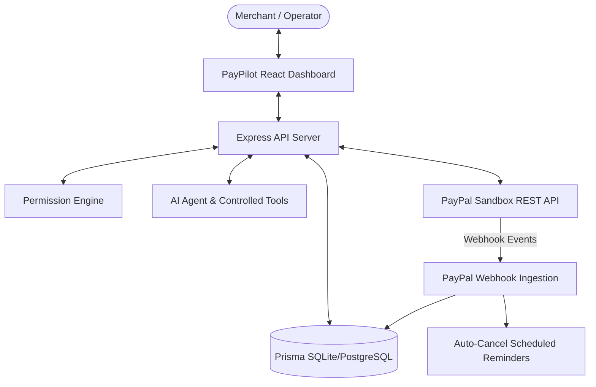

# PayPilot System Architecture

PayPilot is an **AI Revenue Recovery & Customer Intelligence Agent for PayPal** built for the **PayPal AI Hackathon 2026**.

## 1. High-Level Architectural Loop

PayPilot turns passive PayPal payment data into actionable revenue operations:

```text
PAYPAL TRANSACTION TELEMETRY
          ↓
CUSTOMER INTELLIGENCE ENGINE (Behavioral baseline vs 30D activity)
          ↓
REVENUE INTELLIGENCE (Risk detection & root cause calculations)
          ↓
AI REVENUE RECOVERY AGENT (Strategy formulation)
          ↓
PERMISSION ENGINE (Strict 4-Tier Security: READ, COMMUNICATION, LOW_RISK, FINANCIAL)
          ↓
ACTION CENTER (Human-in-the-loop review & approval)
          ↓
PAYPAL WORKFLOW (Invoice reminder / Payment recovery link)
          ↓
CUSTOMER ACTION & SETTLEMENT
          ↓
PAYPAL WEBHOOK (Signature-verified event)
          ↓
FEEDBACK LOOP (Auto-cancel scheduled reminders & update metrics)
```

---

## 2. Component Structure

### A. Frontend Layer (`/client`)
- **React 18 + TypeScript + Vite**
- **Tailwind CSS** custom fintech SaaS dark theme
- **AG Grid Community React** for multi-dimensional customer behavioral analysis
- **Recharts** for monthly volume, recovery trajectories, and aging brackets
- **Interactive 11-Step Demo Stepper** & **PayPal Webhook Simulator**

### B. API & Backend Services Layer (`/server`)
- **Node.js + Express + TypeScript**
- **Prisma ORM** with SQLite/PostgreSQL support
- **Centralized PayPal Service Module** (`/services/paypal`)
  - `paypalAuth.ts`: OAuth 2.0 client credentials token management with cached expiry
  - `paypalClient.ts`: Axios HTTP client with automatic bearer authorization
  - `paypalOrders.ts`: Order creation & capture
  - `paypalInvoices.ts`: Invoicing & reminder dispatch
  - `paypalPayments.ts`: Capture & refund workflows
  - `paypalSubscriptions.ts`: Subscription management & dunning status
  - `paypalTransactions.ts`: Transaction reporting
  - `paypalWebhooks.ts`: Signature verification & idempotent event handling
- **Customer Intelligence Engine** (`/services/customerIntelligence`)
  - Deterministic metrics calculator
  - Rule-based segmentation (Reliable, Reminder-Responsive, At-Risk, High-Value, Overdue, Declining, New, Inactive)
  - "What Changed?" behavior change detector
- **Revenue Intelligence Engine** (`/services/revenueIntelligence`)
  - Real-time aggregation of processed volume, outstanding exposure, and recoverable pipeline
  - Deterministic scenario simulator
  - Root-cause executive insights generator
- **Permission & Safety Engine** (`/services/permissionEngine`)
  - Tier gatekeeper enforcing authorization rules
- **AI Agent & Tool Calling Registry** (`/services/ai`)
  - 15+ explicit backend tools
  - Generative explanation loop backed by real data
- **Compliance Audit Logger** (`/services/audit`)

---

## 3. Data Flow Diagram


